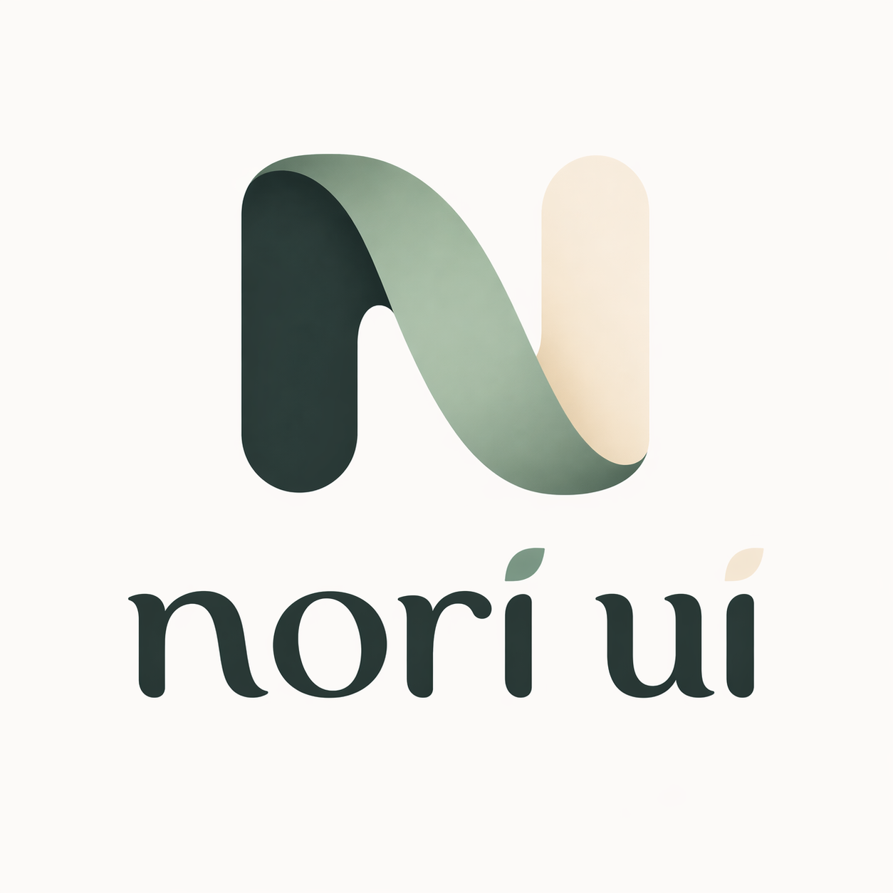

<p align="center">
  
</p>

<h1 align="center">nori-ui</h1>

<p align="center">
  A React Native + Web UI component library.<br />
  Expo-first, New Architecture, styled with NativeWind v4, themed via Figma design tokens.
</p>

---

## Status

Published on npm as [`@nori-ui/core`](https://www.npmjs.com/package/@nori-ui/core). The current version is in [`packages/core/package.json`](./packages/core/package.json); release notes are in [`CHANGELOG.md`](./CHANGELOG.md). Releases are cut automatically from `main` by `semantic-release`.

Documentation: <https://nori-ui.com>

## What it is

`@nori-ui/core` is a set of UI components (buttons, inputs, dialogs, tables, navigation, and more) that render on iOS, Android, and the web from one codebase. Components are built on React Native primitives and render on the web through `react-native-web`.

- **Targets:** Expo SDK 55, React Native 0.83, React 19. On the web: Next.js with `react-native-web`.
- **Styling:** NativeWind v4 (Tailwind CSS 3.4). The package ships its own Tailwind preset.
- **Animation:** Reanimated 4.
- **Theming:** six preset themes, custom themes, and light/dark support through `NoriProvider`.
- **Server Components:** the root entry `@nori-ui/core` is safe to import in React Server Components. Providers and hooks live in `@nori-ui/core/client`.
- **AI tooling:** the docs are available through an MCP server (`@nori-ui/mcp`), `llms.txt`, and `llms-full.txt`.

## Install

```bash
npm install @nori-ui/core nativewind react-native-css-interop react-native-reanimated react-native-worklets
npm install --save-dev tailwindcss@^3.4
```

`nativewind`, `react-native-css-interop`, `react-native-reanimated` (4.3 or newer), `react-native-worklets` (0.8 or newer), and `react` are required peer dependencies. A native app also needs `expo-blur`, `sonner-native`, and `react-native-safe-area-context` installed: they are marked as optional peers, but files reachable from the package entry import them statically, so Metro fails to bundle without them.

Add the preset and the library paths to your Tailwind config:

```js
// tailwind.config.js
/** @type {import('tailwindcss').Config} */
module.exports = {
    presets: [require('@nori-ui/core/tailwind-preset'), require('nativewind/preset')],
    content: [
        './app/**/*.{ts,tsx}',
        './components/**/*.{ts,tsx}',
        './node_modules/@nori-ui/core/dist/**/*.{js,cjs}',
        './node_modules/@nori-ui/core/src/**/*.{ts,tsx}',
    ],
};
```

NativeWind also needs Babel and Metro configuration (Expo) or a `next.config` with `react-native-web` aliases (Next.js). The complete, step-by-step setup for both is in the [Getting started guide](https://nori-ui.com/docs/getting-started) (source: [`apps/docs/content/docs/getting-started.mdx`](./apps/docs/content/docs/getting-started.mdx)).

## Usage

```tsx
import { Button, VStack } from '@nori-ui/core';

export default function Demo() {
    return (
        <VStack gap={3}>
            <Button>Primary</Button>
            <Button variant="secondary">Secondary</Button>
        </VStack>
    );
}
```

Components work without a provider. Add `NoriProvider` to change the theme, translations, locale, or icons:

```tsx
'use client';

import { blueTheme, NoriProvider } from '@nori-ui/core/client';
import type { ReactNode } from 'react';

export function Providers({ children }: { children: ReactNode }) {
    return <NoriProvider theme={blueTheme}>{children}</NoriProvider>;
}
```

`'use client'` is needed in Next.js only.

## Documentation

- [Getting started](https://nori-ui.com/docs/getting-started): install and setup for Expo and Next.js.
- [Theming](https://nori-ui.com/docs/theming): presets and custom themes.
- [Storybook](https://nori-ui.com/storybook): every component with live controls.
- [For AI agents](https://nori-ui.com/docs/for-ai): MCP server, `llms.txt`, `llms-full.txt`.

## Repository layout

| Path | Package | Published | Purpose |
|---|---|---|---|
| `packages/core` | `@nori-ui/core` | yes | The component library. |
| `packages/mcp` | `@nori-ui/mcp` | yes, versioned in lockstep with core | Local MCP server that bundles the docs corpus. |
| `packages/plugin` | `@nori-ui/plugin` | not part of the automated release | Installer for agent skills and the MCP server wiring. |
| `packages/tokens` | `@nori-ui/tokens` | no (private) | Design-token source. Its build output (Tailwind preset, CSS variables, `Theme` type) is copied into `@nori-ui/core`. |
| `packages/tailwindcss-stub` | `@nori-ui/tailwindcss-stub` | not part of the automated release | Stub of `tailwindcss` for Expo Snack only. |
| `apps/docs` | `@nori-ui/docs` | no (private) | Documentation site (Fumadocs, Next.js App Router). |
| `apps/playground-native` | `playground-native` | no (private) | Expo app for developing components on device. |
| `apps/playground-web` | `playground-web` | no (private) | Vite + `react-native-web` playground and Storybook. |
| `e2e/web`, `e2e/native` | | no (private) | Playwright and Maestro end-to-end tests. |

## Quick reference

| Concern | Tool |
|---|---|
| Runtime target | Expo SDK 55 (React Native 0.83, React 19) |
| Node | >= 20 |
| Package manager | Yarn 4 (Berry), `nodeLinker: node-modules` |
| Lint / format | Biome (primary) + ESLint with `eslint-plugin-react-native` (transitional) |
| Styling | NativeWind v4 |
| Testing | Jest + `@testing-library/react-native`, Playwright (web e2e), Maestro (native e2e) |
| Docs | Fumadocs (Next.js App Router) |
| Release | `semantic-release` with npm OIDC trusted publisher |

## Developing

```bash
corepack enable
yarn install
yarn typecheck
yarn lint
yarn test
yarn size
```

Start the playgrounds:

```bash
yarn dev:web       # Vite + react-native-web at http://localhost:5173
yarn dev:native    # Expo at http://localhost:8081
yarn dev:docs      # Fumadocs at http://localhost:3000
yarn dev:storybook # Storybook at http://localhost:6006
```

## Support window

Rolling 3 Expo SDK tiers: current, maintained, legacy. Anchor: SDK 55. Only the current tier (SDK 55) exists so far. See `docs/superpowers/specs/` for the full policy.

## Contributing

Conventional Commits are enforced via commitlint + lefthook. Run `yarn install` once to set up hooks locally. The release process is described in [`RUNBOOK.md`](./RUNBOOK.md).

## License

MIT.
