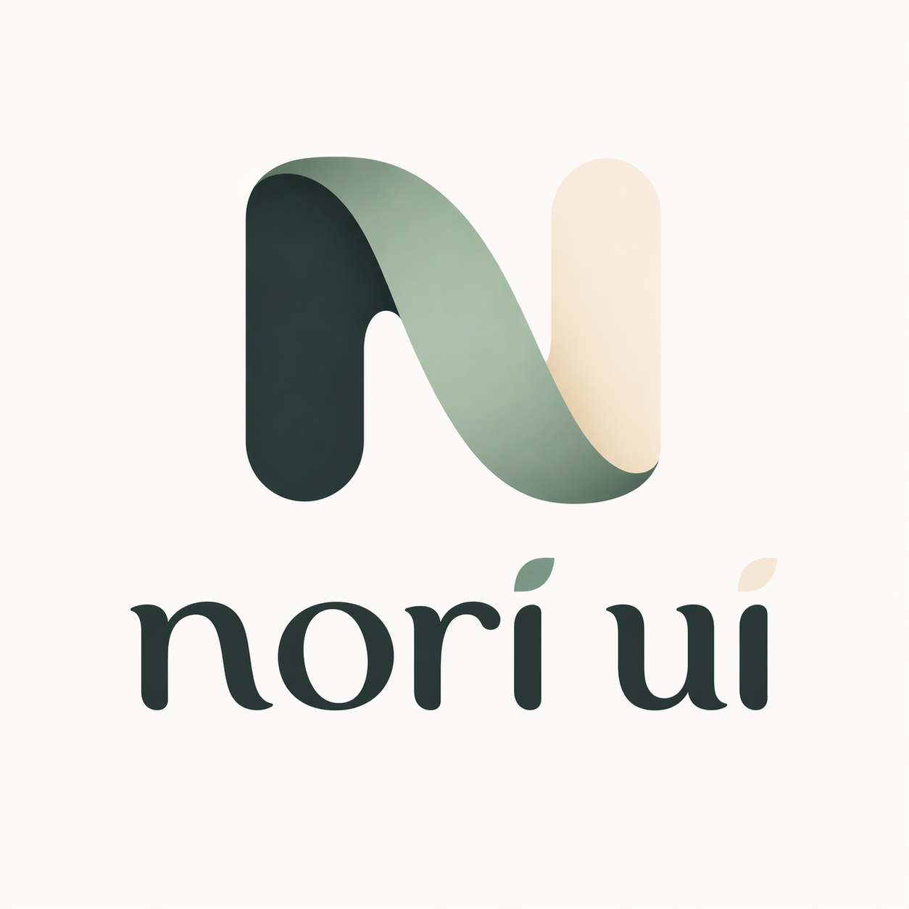

# @nori-ui/core

<p align="center">
  
</p>

A React Native + React Native Web component library for Expo SDK 55
(React Native 0.83, React 19) and Next.js. Ships ESM, CJS, and `.d.ts` builds
in `dist/`, plus the TypeScript source in `src/`, which Metro resolves through
the `react-native` export condition. The default entry is RSC-safe; stateful
providers and hooks are in the `./client` subpath.

## Install

```bash
npm install @nori-ui/core nativewind react-native-css-interop react-native-reanimated react-native-worklets
npm install --save-dev tailwindcss@^3.4
```

Peer dependencies:

| Package | Range | Required |
|---|---|---|
| `react` | `^19` | yes |
| `nativewind` | `^4.2.0` | yes |
| `react-native-css-interop` | `>=0.2.3` | yes |
| `react-native-reanimated` | `>=4.3.0` | yes |
| `react-native-worklets` | `>=0.8.0` | yes |
| `react-native` | `^0.83` | optional (native) |
| `react-dom` | `^19` | optional (web) |
| `react-native-safe-area-context` | `>=4` | optional, see note |
| `expo-blur` | `>=14` | optional, see note |
| `sonner-native` | `>=0.20` | optional, see note |
| `@marceloterreiro/flash-calendar` | `^1` | optional, only for `<Calendar behavior="scroll">` on native |

Note: a native app needs `expo-blur`, `sonner-native`, and `react-native-safe-area-context` installed even though they are marked optional. The native `Dialog` blur backdrop, the native `Toast` bridge, and `FloatButton` import them statically, and those files are reachable from the package entry, so Metro fails to bundle without them. `FloatButton` imports `react-native-safe-area-context` on web as well.

## Tailwind setup

The package ships its Tailwind preset. Add it, and add the library to `content` so Tailwind generates the classes the components use:

```js
// tailwind.config.js
/** @type {import('tailwindcss').Config} */
module.exports = {
    presets: [require('@nori-ui/core/tailwind-preset'), require('nativewind/preset')],
    content: [
        './app/**/*.{ts,tsx}',
        './components/**/*.{ts,tsx}',
        './node_modules/@nori-ui/core/dist/**/*.{js,cjs}',
        './node_modules/@nori-ui/core/src/**/*.{ts,tsx}',
    ],
};
```

The design tokens are also available as CSS custom properties in `@nori-ui/core/theme.css`.

The Babel, Metro, and Next.js configuration is described step by step in the [Getting started guide](https://nori-ui.com/docs/getting-started).

## Usage

The root entry is safe to import in React Server Components:

```tsx
import { Button, VStack } from '@nori-ui/core';

export default function Demo() {
    return (
        <VStack gap={3}>
            <Button>Primary</Button>
            <Button variant="secondary">Secondary</Button>
        </VStack>
    );
}
```

Providers, preset themes, and hooks come from `@nori-ui/core/client`. In Next.js, the importing file needs `'use client'`:

```tsx
'use client';

import { blueTheme, NoriProvider } from '@nori-ui/core/client';
import type { ReactNode } from 'react';

export function Providers({ children }: { children: ReactNode }) {
    return <NoriProvider theme={blueTheme}>{children}</NoriProvider>;
}
```

The provider is optional; components and hooks work without it and use the default theme and English strings.

## Entry points

| Import path | Contents |
|---|---|
| `@nori-ui/core` | Components, `Icon`, `cn`, `Slot`, theme token objects, i18n types. RSC-safe. |
| `@nori-ui/core/client` | Everything in the root entry plus `NoriProvider`, the preset themes, and the hooks (`useTheme`, `useThemeColors`, `useColorScheme`, `useTranslation`, `useLocale`, `useSemanticIcon`). |
| `@nori-ui/core/theme` | Theme types, presets, providers, theme hooks, and `px`. |
| `@nori-ui/core/i18n`, `/icons`, `/slot`, `/utils/cn` | The matching parts of the root entry on their own. |
| `@nori-ui/core/tailwind-preset` | Tailwind preset (CommonJS). |
| `@nori-ui/core/theme.css` | Design tokens as CSS custom properties. |

## Links

- Docs: https://nori-ui.com
- Source: https://github.com/nori-ui/nori-ui

## License

MIT.
